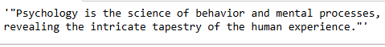
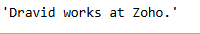

# Experiment: Design and Implementation of LangChain Expression Language (LCEL) Expressions

## AIM

To design and implement LangChain Expression Language (LCEL) expressions by combining prompts, language models, output parsers, and retrievers into executable chains.

## PROBLEM STATEMENT

To implement LCEL chains that accept user input, process it through connected LangChain components, and generate a meaningful response. The experiment demonstrates a simple joke-generation chain and a retrieval-based question-answering chain.

## DESIGN STEPS

### Step 1: Install and import the required libraries

Install the required LangChain packages and load the environment variables containing the OpenAI API key.

### Step 2: Implement a simple LCEL chain

Create a prompt template that accepts a topic, connect it to a chat model and an output parser using the pipe (`|`) operator, and execute it using `invoke()`.

### Step 3: Implement a retrieval-based LCEL chain

Create a vector store using sample documents, convert it into a retriever, and use `RunnableMap` to pass both the retrieved context and the original question to the prompt.

---

## PROGRAM

### 1. Simple Chain – Joke Generator

```python
from dotenv import load_dotenv, find_dotenv
load_dotenv(find_dotenv())

from langchain_core.prompts import ChatPromptTemplate
from langchain_openai import ChatOpenAI
from langchain_core.output_parsers import StrOutputParser

# Create a prompt template
prompt = ChatPromptTemplate.from_template(
    "Tell me a quote about {topic}"
)

# Initialize the language model
model = ChatOpenAI(
    model="gpt-4o-mini",
    temperature=0
)

# Create an output parser
output_parser = StrOutputParser()

# Build the LCEL chain
chain = prompt | model | output_parser

# Execute the chain
result = chain.invoke({"topic": "Life"})

print(result)
```

### 2. Complex Chain – Retrieval-Based Question Answering

```python
from dotenv import load_dotenv, find_dotenv
load_dotenv(find_dotenv())

from langchain_openai import ChatOpenAI, OpenAIEmbeddings
from langchain_core.prompts import ChatPromptTemplate
from langchain_core.output_parsers import StrOutputParser
from langchain_core.runnables import RunnableMap
from langchain_core.vectorstores import InMemoryVectorStore

# Sample documents
texts = [
    "Dravid works at Zoho",
    "Doremon likes to eat doracake"
]

# Create embeddings and vector store
embeddings = OpenAIEmbeddings()
vectorstore = InMemoryVectorStore.from_texts(
    texts,
    embedding=embeddings
)

# Create a retriever
retriever = vectorstore.as_retriever()

# Create the prompt template
prompt = ChatPromptTemplate.from_template(
    """Answer the question based only on the following context:

Context: {context}

Question: {question}"""
)

# Initialize the language model
model = ChatOpenAI(
    model="gpt-4o-mini",
    temperature=0
)

# Create the output parser
output_parser = StrOutputParser()

# Map the input to retrieved context and original question
inputs = RunnableMap({
    "context": lambda x: retriever.invoke(x["question"]),
    "question": lambda x: x["question"]
})

# Build the LCEL chain
chain = inputs | prompt | model | output_parser

# Execute the chain
result = chain.invoke({
    "question": "Where does Dravid live?"
})

print(result)
```

### Output (sample)

```python
chain.invoke({"topic": "Pyscoholgy"})
```



```python
chain.invoke({
    "question": "where did Dravid work?"
})
```



```python
chain.invoke({
    "question": "What does Doremon like to eat?"
})
```


## RESULT

Thus, LangChain Expression Language (LCEL) expressions were designed and implemented successfully. The simple chain generated a topic-based joke, while the retrieval-based chain used embeddings, a vector store, a retriever, and `RunnableMap` to answer questions using the provided sample documents.
